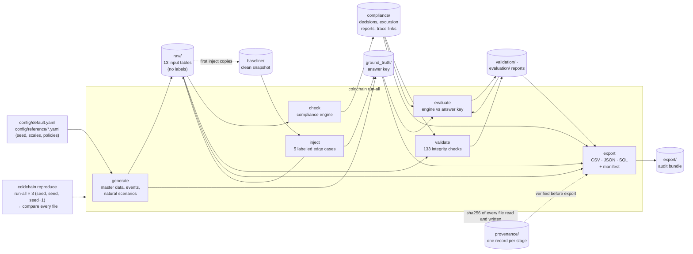
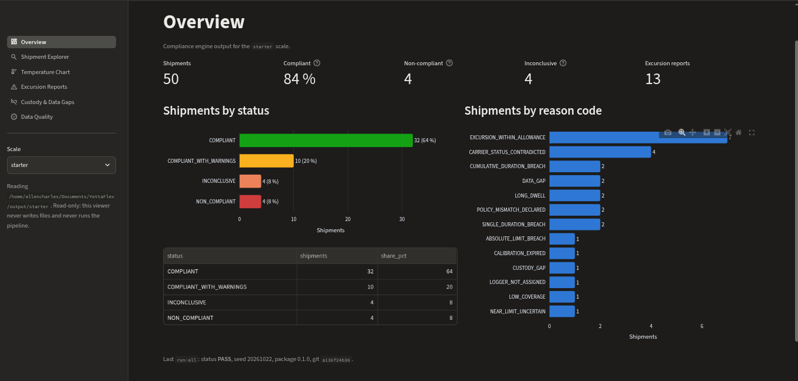
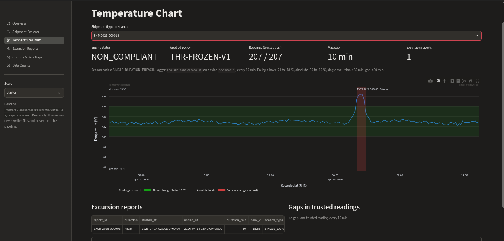
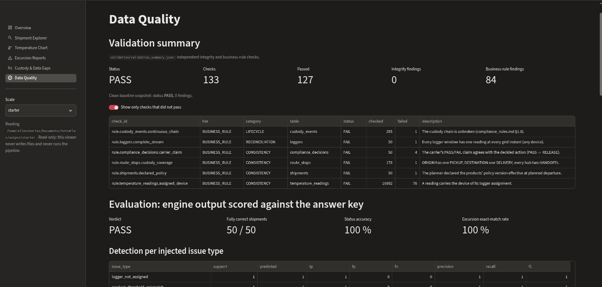

# YottaFlex — Cold Chain Compliance Pipeline

Medicines and vaccines must stay within a temperature range from the factory to the pharmacy.
Every shipment carries a small temperature logger that takes a reading every 10 minutes. Some
company has to look at those readings afterwards and decide: *can this shipment be released, or
must it be quarantined?* That decision has to be explainable. It should point to the exact
readings and the exact rule that caused it.

This project is a **reproducible Python data pipeline** that does exactly that, on
**100 % synthetic data**:

1. **Generates** a realistic cold-chain world: suppliers, carriers and warehouses in Indian
   cities, products, lots, packaging, 1,000 reusable logger devices, 5,000 shipments with
   route stops, custody handoffs and about 1.16 million temperature readings.
2. **Injects** five kinds of deliberate, labelled problems (a wrong logger, a wrong declared
   temperature class, silently missing data, a broken custody chain, and two back-to-back
   shipments that look like one long excursion). The answers go into a separate answer key.
3. **Checks compliance.** A rule engine, which never sees the answer key, decides per shipment
   COMPLIANT / COMPLIANT_WITH_WARNINGS / INCONCLUSIVE / NON_COMPLIANT. Each decision traces
   back to readings and to a versioned threshold policy.
4. **Validates** data integrity independently (133 checks: keys, foreign keys, dates,
   lifecycles, reconciliations).
5. **Evaluates** the engine against the answer key (precision, recall, confusion matrix,
   excursion durations).
6. **Exports** CSV, JSON and portable SQL, with a manifest of checksums, and proves that the SQL
   loads into DuckDB and SQLite.
7. **Proves reproducibility.** The same seed gives byte-identical files, and another seed does
   not.

It is a batch pipeline, not a live tracking app. There are no users, logins or network calls.
An optional read-only [dashboard](#dashboard) shows the results in a browser on your machine.
The people in the brief (supplier, planner, carrier, analyst, operations manager) appear as
*data* (parties in the tables).

How AI was used: see [`docs/AI_USAGE.md`](docs/AI_USAGE.md). Prompt history summary:
[`docs/PROMPT_HISTORY.md`](docs/PROMPT_HISTORY.md).

## Contents

- [Architecture](#architecture)
- [Quick start](#quick-start)
- [CLI reference](#cli-reference)
- [Outputs explained](#outputs-explained)
- [How to trace a decision (worked example)](#how-to-trace-a-decision-worked-example)
- [Dashboard](#dashboard)
- [Evaluation results](#evaluation-results)
- [Reproducibility and performance](#reproducibility-and-performance)
- [Design decisions](#design-decisions)
- [Assumptions and limitations](#assumptions-and-limitations)
- [Data provenance](#data-provenance)
- [Security & Audit](#security--audit)
- [Project layout](#project-layout)
- [Known issues](#known-issues)

## Architecture



The rules that keep it honest:

- **The engine reads `raw/` only.** It never opens `ground_truth/` or `baseline/`. Static
  import scans, plus an audit hook that records every file the engine opens, enforce this.
- **Validation does not reuse the engine.** It recomputes windows, excursions, coverage and
  gaps itself, so when the engine agrees with it, that agreement is evidence.
- **Every stage writes a provenance record** with the sha256 of every file it read and wrote.
  `export` refuses to run if any record no longer matches the files, if the stages used
  different configs or seeds, or if the evaluation verdict is not PASS.
- **Pure functions inside, I/O at the edge.** `generate/`, `inject/`, `compliance/`,
  `validation/` and `evaluation/` take DataFrames and return DataFrames. Only `io.py`,
  `pipeline.py` and `cli.py` touch files.

## Quick start

Requirements: Linux or macOS, **Python 3.12** (3.11–3.13 supported; the lockfile was made with
3.12), git. No network access is needed after installation.

```bash
git clone <repository-url> yottaflex && cd yottaflex
python3.12 -m venv .venv && source .venv/bin/activate
pip install --require-hashes -r requirements-dev.lock   # exact, hash-checked dependency versions
pip install --no-deps -e .                              # the coldchain package itself
coldchain version                                       # coldchain 0.1.0 (Python 3.12.x)

coldchain run-all --scale starter        # whole pipeline, 50 shipments, about 10 s
cat output/starter/run_summary.json      # what each stage did, how long it took
coldchain reproduce --scale starter      # same seed → identical files (about 25 s)
pytest                                   # full test suite (pytest -m "not slow" for a fast run)
streamlit run app/streamlit_app.py       # read-only dashboard over output/ (see Dashboard)
```

`run-all --scale full` (5,000 shipments) takes about 4 minutes and needs about 2 GB of RAM and
1 GB of disk. Everything is written under `output/`, which git ignores.

**Dependencies.** `pyproject.toml` declares version ranges. The lockfiles pin the exact versions
the test suite ran against, each with its sha256 hashes: `requirements.lock` (runtime) and
`requirements-dev.lock` (runtime plus tests, lint, audit and the streamlit dashboard). With `--require-hashes`, pip
refuses any file whose hash differs. `pip install -e ".[dev]"` also works, but resolves the
newest versions within the ranges. To refresh the locks after upgrading the venv, run
`scripts/lock_dependencies.sh` (needs `uv` and network access). `tests/test_lockfile.py` fails
when the installed versions drift from the lock.

## CLI reference

Global options, given before the command: `--log-level DEBUG|INFO|WARNING|ERROR` (default
INFO) and `-v/--verbose` (shorthand for DEBUG). Example: `coldchain --log-level WARNING run-all`.

Common options: `--scale starter|full` (default `starter`: 50 shipments and 20 devices; `full`:
5,000 and 1,000), `--config PATH` (default `config/default.yaml`), and `--output-dir DIR`
(default `output/`; files go to `DIR/<scale>/`).

| Command | What it does | Extra options |
|---|---|---|
| `coldchain version` | Print the package and Python versions. | |
| `coldchain generate` | Generate every raw table and the answer key (`expected_outcomes`, `device_truth`). Removes a stale injection. | `--seed N` |
| `coldchain inject` | Inject the five edge cases into about 1 % of shipments each. Snapshots the clean data to `baseline/` first; re-running is idempotent. Writes `ground_truth/anomalies`. | `--seed N` (must match `generate`) |
| `coldchain check` | Run the compliance engine on `raw/` and write `compliance/`. | |
| `coldchain validate` | Run 133 integrity and business-rule checks and write `validation/validation_summary.{md,json}`. Exit 1 on an INTEGRITY failure. | `--source raw\|baseline` |
| `coldchain evaluate` | Score the engine against the answer key and explain every validation finding. Writes `evaluation/evaluation_report.{md,json}`. Exit 1 on any unexplained finding or any metric below 100 % (strict scales). | |
| `coldchain export` | Write the audit bundle `export/` (CSV, JSON, SQL, reports, manifest) after verifying the provenance chain. Proves the SQL loads into DuckDB and SQLite. | `--verify-sql/--no-verify-sql` (default on) |
| `coldchain run-all` | generate → inject → check → validate → validate baseline → evaluate → export in one process. Stops at the first failing stage and names it. Writes `run_summary.json`. | `--seed N`, `--verify-sql/--no-verify-sql` |
| `coldchain reproduce` | Run `run-all` three times (seed, seed, control seed) and compare the row count and sha256 of every file. Writes `reproducibility/reproducibility_check.{md,json}`. Exit 1 on any mismatch. | `--seed N`, `--control-seed N` (default seed + 1), `--verify-sql/--no-verify-sql` (default off), `--keep-runs` |

Every command exits with status 0 on success and 1 on failure, with a one-line `Error: …`
message. Each command logs its row counts, output folders, duration and peak memory
(`Stage check done in 0.52 s, peak RSS 265.2 MiB`).

To run the stages one by one (equivalent to `run-all`, byte for byte):

```bash
coldchain generate --scale starter
coldchain inject   --scale starter
coldchain check    --scale starter
coldchain validate --scale starter
coldchain validate --scale starter --source baseline
coldchain evaluate --scale starter
coldchain export   --scale starter
```

To plot one shipment's readings against its policy band (needs the `dev` extra):
`python scripts/plot_shipment.py SHP-2026-000018 [--engine]` →
`output/starter/plots/SHP-2026-000018.png`.

## Outputs explained

```
output/<scale>/
├── raw/                 13 input tables (Parquet + CSV): parties, threshold_policies, products,
│                        packaging, lots, devices, shipments, shipment_lots, loggers,
│                        temperature_readings, route_stops, custody_events, shipment_status_events
├── baseline/            byte-for-byte copy of the clean raw/ tables and expected_outcomes,
│                        taken before the first injection
├── ground_truth/        the answer key: expected_outcomes (per shipment), device_truth (hidden
│                        sensor offsets), anomalies (+ .json). Never read by the engine
├── compliance/          engine output: compliance_decisions, excursion_reports,
│                        excursion_report_readings (the trace links), compliance_status_events
├── validation/          validation_summary.{md,json} (+ baseline/ for the clean snapshot)
├── evaluation/          evaluation_report.{md,json}
├── export/              the audit bundle (below)
├── provenance/          <stage>.json: command, seed, config hash, git commit, sha256 of inputs
│                        and outputs
├── run_summary.json     the last run-all: every stage's status, rows, verdict, duration, memory
└── reproducibility/     reproducibility_check.{md,json} from `coldchain reproduce`
```

| Table | One row per | Key columns |
|---|---|---|
| `compliance_decisions` | shipment | `status`, `reason_codes` (`\|`-separated), `decided_action` (RELEASE / QUARANTINE / REVIEW), `applied_policy_id`, `coverage_pct`, `max_gap_min`, `total_excursion_min`, `excursion_report_ids` |
| `excursion_reports` | excursion (a run of out-of-range readings) | `direction`, `started_at`, `ended_at`, `duration_min`, `peak_c`, `breach_type`, `first_reading_id`, `last_reading_id` |
| `excursion_report_readings` | (report, reading) link | `report_id`, `reading_id` |
| `compliance_status_events` | status change appended by the engine | UNDER_REVIEW → RELEASED / QUARANTINED, with the analyst and manager parties |
| `expected_outcomes` | shipment (answer key) | `scenario`, `issue_type`, `expected_status`, `expected_reason_codes`, `expected_excursion_windows` |
| `anomalies` | injected anomaly × affected shipment | `issue_type`, `affected_record_ids`, `removed_record_ids`, `expected_status` |

Every table and field is documented in [`docs/data_dictionary.md`](docs/data_dictionary.md),
the relationships in [`docs/er_diagram.md`](docs/er_diagram.md), the rules in
[`docs/compliance_rules.md`](docs/compliance_rules.md), the edge cases in
[`docs/anomaly_catalogue.md`](docs/anomaly_catalogue.md), and the checks and metrics in
[`docs/evaluation.md`](docs/evaluation.md).

**The export bundle** (`output/<scale>/export/`) is what you hand to someone else:

- `csv/<layer>/` and `json/<layer>/`: every table, the answer key in its own `ground_truth/`
  folders (`temperature_readings` as JSON Lines);
- `sql/schema.sql` + `sql/seed.sql`: DDL with primary and foreign keys, then batched INSERTs,
  for the raw and compliance tables. `sql/ground_truth_*.sql` holds the answer key, never mixed
  in;
- `reports/`, `docs/data_dictionary.md`, a `README.md`;
- `manifest.json`: seed, scale, every stage's command, package version, git commit and dirty
  flag, config hash, the sha256 of every input, the row count and sha256 of every bundle file,
  and the DuckDB/SQLite load proof. `dataset_sha256` identifies the data. `content_sha256`
  covers everything except the export timestamp.

## How to trace a decision (worked example)

Take **SHP-2026-000018** from `coldchain run-all --scale starter` (default seed). It is a FROZEN
product that got too warm for too long.

**1. The decision.** In `compliance/compliance_decisions.csv`:

| shipment_id | applied_policy_id | policy_source | status | reason_codes | decided_action | coverage_pct | max_gap_min | total_excursion_min | excursion_report_ids |
|---|---|---|---|---|---|---:|---:|---:|---|
| SHP-2026-000018 | THR-FROZEN-V1 | DECLARED_CONFIRMED | NON_COMPLIANT | SINGLE_DURATION_BREACH | QUARANTINE | 100.0 | 10 | 50 | EXCR-2026-000003 |

The logger recorded all 207 expected readings (100 % coverage, no gap above 10 min), so the data
is complete, and one excursion broke the policy.

**2. The policy.** `applied_policy_id` → `raw/threshold_policies.csv`. The engine resolves the
policy from the products in the shipment and the actual departure date (2026-04-13). It also
checks the planner's declaration, which agreed here (`DECLARED_CONFIRMED`).

| policy_id | min_c | max_c | abs_min_c | abs_max_c | max_single_excursion_min | max_cumulative_excursion_min |
|---|---:|---:|---:|---:|---:|---:|
| THR-FROZEN-V1 | −24.0 | −18.0 | −30.0 | −15.0 | 30 | 60 |

**3. The excursion.** `excursion_report_ids` → `compliance/excursion_reports.csv`:

| report_id | direction | started_at | ended_at | reading_count | peak_c | duration_min | breach_type |
|---|---|---|---|---:|---:|---:|---|
| EXCR-2026-000003 | HIGH | 2026-04-14T02:00:00Z | 2026-04-14T02:40:00Z | 5 | −15.56 | 50 | SINGLE_DURATION_BREACH |

The duration is `(ended_at − started_at) + reading interval = 40 + 10 = 50 min`, which is more
than the 30 min allowed, so this is a SINGLE_DURATION_BREACH. The peak of −15.56 °C did not pass
the absolute limit of −15 °C, so it is not an ABSOLUTE_LIMIT_BREACH.

**4. The readings.** `report_id` → `compliance/excursion_report_readings.csv` gives five reading
IDs. Look them up in `raw/temperature_readings.csv` (device DEV-000011):

| reading_id | recorded_at | temperature_c | |
|---|---|---:|---|
| TEMP-LOG-SHP-2026-000018-01-20260414T0150 | 01:50 | −19.06 | in range |
| TEMP-LOG-SHP-2026-000018-01-20260414T0200 | 02:00 | **−16.56** | above −18 → excursion starts |
| TEMP-LOG-SHP-2026-000018-01-20260414T0210 | 02:10 | **−15.80** | |
| TEMP-LOG-SHP-2026-000018-01-20260414T0220 | 02:20 | **−15.62** | |
| TEMP-LOG-SHP-2026-000018-01-20260414T0230 | 02:30 | **−15.56** | peak |
| TEMP-LOG-SHP-2026-000018-01-20260414T0240 | 02:40 | **−16.46** | last out-of-range reading |
| TEMP-LOG-SHP-2026-000018-01-20260414T0250 | 02:50 | −19.20 | back in range |

**5. The consequence.** `compliance/compliance_status_events.csv` appends UNDER_REVIEW
(analyst PTY-0036) and then QUARANTINED (operations manager PTY-0038) to the shipment's
history. The raw history is never modified. The carrier had reported FAIL, which agrees, so
there is no CARRIER_STATUS_CONTRADICTED.

**6. The cross-check.** `ground_truth/expected_outcomes.csv` says this shipment was generated
as an EXCURSION_BREACH scenario with expected status NON_COMPLIANT and a 50-minute excursion.
The engine never saw that file, but it reached the same answer.

The same trace in SQL, on the exported bundle (DuckDB):

```sql
-- duckdb trace.duckdb < export/sql/schema.sql && duckdb trace.duckdb < export/sql/seed.sql
SET TimeZone = 'UTC';
SELECT d.status, d.reason_codes, p.max_c, p.max_single_excursion_min AS allowed_min,
       r.report_id, r.duration_min, r.breach_type, t.recorded_at, t.temperature_c
FROM compliance_decisions d
JOIN threshold_policies p        ON p.policy_id = d.applied_policy_id
JOIN excursion_reports r         ON r.shipment_id = d.shipment_id
JOIN excursion_report_readings x ON x.report_id = r.report_id
JOIN temperature_readings t      ON t.reading_id = x.reading_id
WHERE d.shipment_id = 'SHP-2026-000018'
ORDER BY t.recorded_at;
```

## Dashboard

A read-only streamlit viewer over the files `run-all` wrote. There is no login, it never
writes to `output/`, and it never runs the pipeline.

```bash
pip install --require-hashes -r requirements-dev.lock && pip install --no-deps -e .  # includes it
# or, without the lockfile:  pip install -e ".[dashboard]"
coldchain run-all --scale starter          # the viewer needs this output first
streamlit run app/streamlit_app.py         # then open http://localhost:8501
```

Pick the scale in the sidebar. If its output is missing (for example in a fresh clone), every
page says *Run `coldchain run-all --scale <scale>` first*. To read another output root, set
`COLDCHAIN_OUTPUT_DIR=/path/to/output`.



*Overview (starter scale): 50 shipments, 84 % compliant, 4 non-compliant, 4 inconclusive and 13
excursion reports, with shipments by status and by reason code.*



*Temperature Chart for SHP-2026-000018: the readings stay in the green −24 to −18 °C band
except for one red 50-minute window (EXCR-2026-000003) that peaks just below the dashed
−15 °C absolute limit, so the shipment is NON_COMPLIANT (SINGLE_DURATION_BREACH).*



*Data Quality: 133 validation checks with 0 integrity findings and the 6 business-rule checks
that the injected anomalies trip, then the evaluation verdict (PASS, 50 / 50 shipments fully
correct).*

| Page | What it shows |
|---|---|
| Overview | KPI tiles (shipments, % compliant = COMPLIANT + COMPLIANT_WITH_WARNINGS, non-compliant, inconclusive, excursion reports), shipments per status and per reason code |
| Shipment Explorer | Search a shipment: its decision, lots and products, packaging, logger, device and calibration, route stops, custody timeline (broken links explained), and the status history (raw lifecycle, then the engine's events) |
| Temperature Chart | The readings against the applied policy: green allowed band, dashed absolute limits, red windows for the engine's excursion reports, grey windows for gaps in the trusted readings (darker when the gap breaks the policy), and crosses for readings from the wrong device |
| Excursion Reports | Filter by direction, breach type, policy or ID. Each report shows its policy and its linked readings (from `excursion_report_readings`), and opens its shipment's chart |
| Custody & Data Gaps | Shipments flagged CUSTODY_GAP, DATA_GAP, LOW_COVERAGE or LOGGER_NOT_ASSIGNED, with the custody chain and the reading gaps of each |
| Data Quality | The validation summary (and the clean baseline's), the evaluation metrics and confusion matrix, the answer key vs the engine per shipment, and the `coldchain reproduce` result (or how to produce it) |

Everything taken from `ground_truth/` is labelled **Answer key (ground truth)**, and its
columns start with `answer_key_`, so it is never mistaken for engine output. At full scale
(1.16 million readings) a page loads in about a second the first time and in about 0.1 s
after that: tables are cached per file, and the chart reads only the selected shipment's
readings (a pyarrow filter). Streamlit's usage statistics are switched off in
`.streamlit/config.toml`, and the server listens on `localhost` only.

## Evaluation results

Default seed `20261022`. Every number comes from `evaluation/evaluation_report.json`;
definitions are in [`docs/evaluation.md`](docs/evaluation.md).

| Metric | starter (50 shipments) | full (5,000 shipments) |
|---|---|---|
| Verdict (strict: every metric must be 100 %) | **PASS** | **PASS** |
| Shipments fully correct (status, action, every reason code, every excursion) | 50 / 50 | 5,000 / 5,000 |
| Excursion duration exact-match rate | 13 / 13 (100 %) | 920 / 920 (100 %) |
| Validation integrity findings | 0 | 0 |
| Business-rule findings explained by an injected anomaly | 84 / 84 | 13,160 / 13,160 |
| Anomalies surfaced by validation | 4 / 4 | 200 / 200 |

Detection per injected issue type (true positive = flagged **and** the exact expected status,
reason codes and excursion durations):

| Issue type | starter: support · P · R | full: support · P · R · F1 |
|---|---|---|
| `logger_not_assigned` | 1 · 1.00 · 1.00 | 50 · 1.00 · 1.00 · 1.00 |
| `product_threshold_mismatch` | 1 · 1.00 · 1.00 | 50 · 1.00 · 1.00 · 1.00 |
| `missing_data_silently_passed` | 1 · 1.00 · 1.00 | 50 · 1.00 · 1.00 · 1.00 |
| `custody_gap_not_flagged` | 1 · 1.00 · 1.00 | 50 · 1.00 · 1.00 · 1.00 |
| `excursion_across_unrelated_shipments` | 2 · 1.00 · 1.00 | 50 · 1.00 · 1.00 · 1.00 |

The clean baseline (before injection) has **0 findings** in all 133 validation checks at both
scales.

**Why 100 % is not suspicious here.** The engine and the answer key were written independently
from the same documented rules. The answer key is derived from what the generator *designed*,
never from scanning readings or running the engine, and an independent re-scan test confirms it
matches the data. With synthetic data and exact rules, any disagreement is a bug, and the
strict mode makes every bug fail the run. One such bug was found and fixed during development:
the first full-scale run scored 96 % precision on one issue type (see
[`docs/evaluation.md` §5](docs/evaluation.md#5-evaluation-history)).
That is not evidence that the rules suit real-world data; see the limitations below.

## Reproducibility and performance

`coldchain reproduce` runs the whole pipeline twice with the same seed and once with seed + 1.
It then compares **every file** the runs wrote: the rows of every table file and the sha256 of
the bytes. Three run records are the exceptions, compared on their content without the
wall-clock value they hold: the manifest's `generated_at`, the run summary's timings, and the
export provenance record's hash of the manifest. The report is
`output/<scale>/reproducibility/reproducibility_check.md`, with one row per file (file, rows
run1, rows run2, sha256 match).

| Scale | Files compared | Identical (run1 vs run2) | Changed by the control seed | Duration of `reproduce` |
|---|---:|---:|---:|---:|
| starter | 134 | 134 | 119 (the 15 unchanged ones are reference data: packaging, threshold policies, DDL, data dictionary) | about 25 s |
| full | 134 | 134 | 119 (the same 15 reference files) | 5 min 21 s (three runs of about 99 s each, without the SQL proof) |

Full-scale `run-all`, per stage (one run; peak RSS is the process's peak during that stage):

| Stage | Seconds | Peak RSS (MiB) | What it produces |
|---|---:|---:|---|
| generate | 22.2 | 855 | 13 raw tables (1,162,819 readings) + answer key |
| inject | 23.5 | 1,033 | 250 injected shipments, `anomalies` |
| check | 8.1 | 918 | 5,000 decisions, 920 excursion reports |
| validate | 11.8 | 1,068 | 133 checks, 0 integrity findings |
| validate (baseline) | 9.7 | 927 | 133 checks on the clean snapshot, 0 findings |
| evaluate | 2.9 | 702 | verdict PASS, 5,000 / 5,000 fully correct |
| export | 140.5 | 1,632 | 50 files (505 MiB) + manifest; DuckDB and SQLite load proof PASS |
| **total** | **218.7** | **1,632** | `dataset_sha256` `38597ecb25ff…` (equal to both reproduce runs) |

Measured on the development laptop (Fedora, Python 3.12) from the Phase 8 working tree, default
seed.

The full run writes about 0.8 GB, and its peak memory is about 1.6 GiB. The export
stage's DuckDB load proof (`--verify-sql`, on by default) takes most of its time. DuckDB's
literal-INSERT path is slow (about 70 µs per row), and `--no-verify-sql` skips it (DECISIONS.md
#107).

## Design decisions

Every decision, with its date and reason, is in [`docs/DECISIONS.md`](docs/DECISIONS.md)
(131 entries). The ones that shape the project most:

- **Device vs logger** (#1): 1,000 physical *devices* are reused across 5,000 shipments, and a
  *logger* is one device assigned to one shipment (`LOG-<shipment-id>-01`).
- **Named RNG streams** (#3, #30): one `np.random.Generator` per table and step, keyed by
  name, so changing one generator never changes another table.
- **Answer key from design, not from the engine** (#43, #70): expected outcomes are derived from
  what the generator built, so evaluating the engine is not circular.
- **Injection from a baseline snapshot** (#67): `inject` always starts from the clean copy, so
  a diff proves it changed only its target shipments.
- **Excursions per logger assignment, never per device** (#9, #76): the back-to-back trap.
- **Half-open policy windows and strict boundaries** (#12, #15): a reading exactly at the limit
  passes, and a 30-minute excursion under a 30-minute allowance passes.
- **Two-tier validation** (#84): integrity failures stop the pipeline; business-rule findings
  must each be explained by an injected anomaly.
- **Provenance chain** (#98, #108, #112): one record per stage, checked before export. The same
  config, the same seed and unchanged files are required.
- **Portable SQL with a load proof** (#99, #100) and **hash-pinned lockfiles** (#103).
- **`run-all` = the single commands** (#114) and **reproducibility over every file** (#117).

## Assumptions and limitations

- **Synthetic world.** The temperature model (setpoint, drift, noise, warming during stops) is
  plausible but not calibrated to any real lane, packaging or season. Results say nothing
  about how often real shipments fail.
- **Designed anomalies.** The engine is scored only on the five anomaly types it was designed
  for, injected in a controlled way. Real data has messier, overlapping failure modes (sensor
  drift, clock skew, duplicated uploads), and none of those are modelled.
- **Natural readings never sit near a limit by accident.** Natural readings stay inside a safe
  band, and only designed segments approach or cross limits (DECISIONS.md #42). This keeps the
  answer key exact. It also means no natural "borderline" cases exist, other than the designed
  BOUNDARY scenario.
- **One logger per shipment, one temperature class per container**, readings every 10 minutes
  on a fixed grid, UTC timestamps. Multi-logger shipments, mixed loads and irregular reading
  intervals are out of scope.
- **Rules are deterministic thresholds.** There is no mean kinetic temperature (MKT), no
  stability budget across a product's life, and no product-specific excursion tables beyond
  the four policies (plus one versioned change).
- **Geography** is 19 Indian cities with approximate coordinates; road distance is
  great-circle distance × 1.3 (DECISIONS.md #23, #32).
- **Scale.** 5,000 shipments run in a few minutes on a laptop with about 2 GB of RAM. Much
  larger volumes would need chunked processing, which is not implemented.
- **Peak memory** is measured per stage on Linux. On other systems it falls back to the process
  peak so far (DECISIONS.md #115).

## Data provenance

**100 % synthetic; no external data used.** Every row is produced by the code in this
repository from `config/` and a seed. There are no downloads, APIs, datasets or personal data.
Party, product, packaging and device-model names are generated labels such as
`Pune Supplier 03`. A test rejects about 90 real pharmaceutical, logistics and cold-chain brand
names. City coordinates are approximate city centres from general knowledge (DECISIONS.md
#23). Every exported file can be traced to its seed, config hash, command and git commit
through `manifest.json` and `provenance/`.

## Security & Audit

| Concern | Control | Where it is enforced |
|---|---|---|
| Untrusted YAML | Only `yaml.safe_load` is used. An AST scan forbids `yaml.load`, `full_load`, `unsafe_load` and unsafe loaders, and a `!!python/object` config is refused. | `config.py`, `tests/test_security.py` |
| Config typos and bad values | pydantic models with `extra="forbid"` and cross-field rules; a clear `ConfigError` names the file and field. | `config.py`, `tests/test_config.py` |
| SQL injection via data values | One escaping function: text in single quotes with `'` doubled, identifiers snake_case-checked and double-quoted, NUL and infinities refused. Tested with `O'Brien; DROP TABLE parties;--` and similar values. | `export/sql.py`, `tests/test_export_sql.py` |
| Supply chain | Hash-pinned lockfiles (`pip install --require-hashes`); `pip-audit --skip-editable` reported no known vulnerabilities at Phase 6/7; a test fails if the installed versions drift from the lock. | `requirements*.lock`, `tests/test_lockfile.py` |
| Answer-key leakage | The engine and the validation suite never import the generator or injector, never name ground-truth tables, and run with `ground_truth/` deleted while an audit hook records every file they open. Strict schemas stop label columns leaking into `raw/`. | `tests/test_compliance_isolation.py`, `tests/test_validation_isolation.py` |
| Tampering and stale results | Every stage records the sha256 of every input and output. `export` verifies the whole chain (unchanged files, one config, one seed, PASS verdict) and refuses otherwise. The bundle is written to a staging folder and swapped in only on success. | `provenance.py`, `pipeline.run_export` |
| Audit trail | `manifest.json` (per-file sha256 and rows, `dataset_sha256`, `content_sha256`, git commit and dirty flag, every stage's command and seed); `run_summary.json` (status, timing and memory per stage); `reproducibility_check.json`. Raw history is append-only: the engine writes its status events to a separate table. | `export/manifest.py`, `observability.py` |
| Determinism | No wall-clock time in any data file; the only timestamps live in blocks excluded from the content hashes. Tables are sorted by primary key, and floats use fixed rounding. | `coldchain reproduce` |
| Attack surface | The pipeline has no server, authentication, network access or subprocess with user input. The only subprocess is `git` with a fixed argument list (for the commit hash). The optional dashboard is a local streamlit server on `localhost`, read-only (no write call, no pipeline import, checked by an AST scan and a before/after checksum test), with usage statistics off. | `provenance.git_state`, `tests/test_viewer_app.py`, `.streamlit/config.toml` |

To audit a delivered bundle: re-run `coldchain run-all --scale <scale>` at the commit named in
its manifest, and compare `dataset_sha256`. Or run `sha256sum` over the files listed in
`manifest.json`.

## Project layout

- `config/`: pipeline configuration (`default.yaml`) and reference data (`reference/*.yaml`:
  threshold policies, products, packaging, locations)
- `src/coldchain/`: the package
  - `cli.py` (typer commands), `pipeline.py` (stage runners, `run-all`, `reproduce`),
    `observability.py` (logging, timing, memory, run summary)
  - `config.py`, `enums.py`, `errors.py`, `ids.py` (every ID format), `rng.py`,
    `schemas.py` (pandera schema of every table), `io.py` (all file reading and writing),
    `provenance.py`
  - `generate/` (data generators), `inject/` (anomaly injectors), `compliance/` (the engine),
    `validation/` (integrity checks), `evaluation/` (metrics), `export/` (CSV/JSON/SQL
    bundle, manifest, reproducibility comparison)
- `tests/`: pytest suite, one test file per module
- `app/`: the streamlit dashboard (`streamlit_app.py` and one file per page in `views/`); its
  logic is in `src/coldchain/viewer/` (`data.py` reads, `views.py` and `charts.py` are pure,
  `session.py` holds the streamlit caching and widgets)
- `scripts/`: `plot_shipment.py` (one shipment's readings as a PNG) and `lock_dependencies.sh`
  (regenerates the lockfiles)
- `requirements.lock`, `requirements-dev.lock`: hash-pinned dependency versions
- `docs/`: [`PROJECT_PLAN.md`](docs/PROJECT_PLAN.md), [`DECISIONS.md`](docs/DECISIONS.md),
  [`brief.md`](docs/brief.md), [`data_dictionary.md`](docs/data_dictionary.md),
  [`er_diagram.md`](docs/er_diagram.md), [`compliance_rules.md`](docs/compliance_rules.md),
  [`anomaly_catalogue.md`](docs/anomaly_catalogue.md), [`evaluation.md`](docs/evaluation.md),
  [`BACKLOG.md`](docs/BACKLOG.md), [`AI_USAGE.md`](docs/AI_USAGE.md)

## Known issues

- **`nanobind: leaked … instances` at exit.** DuckDB 2.0's Python bindings sometimes print this
  message when a process that used DuckDB exits (some pytest runs, `export`, `run-all`). It is
  cosmetic: the exit status and the results are unaffected. It comes from the DuckDB wheel, not
  from this project.
- **The DuckDB load proof is slow at full scale** (about 95 s of the export stage), because
  DuckDB inserts literal rows slowly. Use `--no-verify-sql` for development runs; the proof
  stays on by default, because it is part of the deliverable.
- **Peak memory inside `run-all` is an upper bound.** One process runs every stage, so a stage's
  peak includes memory still held from earlier stages.
- **The dashboard reads whatever is on disk.** If a pipeline stage is re-run while the viewer is
  open, a page can briefly combine files from two runs. Reload after the run finishes.
