# ER Diagram

All 19 tables and their relationships. Field-level detail (types, rules) is in
[`data_dictionary.md`](data_dictionary.md). Crow's-foot notation: `||` exactly one, `o|` zero or
one, `|{` one or more, `o{` zero or more. A dotted line (`..`) is a *logical* reference that is not
a single-column foreign key (resolved by `policy_code` + effective date).

> Rendering: GitHub renders Mermaid natively. In VS Code, the built-in Markdown preview needs the
> *Markdown Preview Mermaid Support* extension (`bierner.markdown-mermaid`).

## Layers at a glance

| Layer | Tables |
|---|---|
| raw (generator input) | parties, threshold_policies, products, packaging, lots, devices, shipments, shipment_lots, loggers, temperature_readings, route_stops, custody_events, shipment_status_events |
| compliance (engine output) | excursion_reports, excursion_report_readings, compliance_decisions, compliance_status_events |
| ground_truth (answer key) | expected_outcomes, anomalies |

## Diagram

```mermaid
erDiagram
    parties ||--o{ products : "supplies"
    parties ||--o{ shipments : "supplier / carrier / receiver / planner"
    parties ||--o{ route_stops : "hosts stop"
    parties ||--o{ custody_events : "from / to party"
    parties ||--o{ shipment_status_events : "acts on"
    parties ||--o{ compliance_status_events : "reviews / decides"

    threshold_policies }|..o{ products : "policy_code by effective date"
    threshold_policies ||--o{ shipments : "declared (planner)"
    threshold_policies ||--o{ excursion_reports : "evaluated under"
    threshold_policies ||--o{ compliance_decisions : "applied"

    products ||--o{ lots : "produced as"
    lots ||--o{ shipment_lots : "shipped in"
    shipments ||--|{ shipment_lots : "carries"
    packaging ||--o{ shipments : "packs"

    shipments ||--|| loggers : "monitored by"
    devices ||--o{ loggers : "assigned as"
    loggers ||--o{ temperature_readings : "records"
    devices ||--o{ temperature_readings : "measured by"

    shipments ||--|{ route_stops : "routes via"
    route_stops ||--o{ custody_events : "handoff at"
    shipments ||--|{ custody_events : "custody chain"
    shipments ||--|{ shipment_status_events : "lifecycle"

    shipments ||--o{ excursion_reports : "has"
    loggers ||--o{ excursion_reports : "detected on"
    excursion_reports ||--|{ excursion_report_readings : "traced to"
    temperature_readings ||--o| excursion_report_readings : "evidence for"
    shipments ||--|| compliance_decisions : "decided as"
    shipments ||--o{ compliance_status_events : "review history"

    shipments ||--|| expected_outcomes : "expected (ground truth)"
    shipments ||--o{ anomalies : "injected (ground truth)"

    parties {
        string party_id PK
        string party_type
        string name
        string city
        date active_from
    }
    threshold_policies {
        string policy_id PK
        string policy_code
        int version
        float min_c
        float max_c
        float abs_min_c
        float abs_max_c
        int max_single_excursion_min
        int max_cumulative_excursion_min
        int max_reading_gap_min
        float min_coverage_pct
        date effective_from
        date effective_to "nullable = open-ended"
    }
    products {
        string product_id PK
        string name
        string category
        string supplier_party_id FK
        string policy_code "logical ref"
        int shelf_life_days
    }
    packaging {
        string packaging_id PK
        string name
        string packaging_type
        string supported_policy_code
        float setpoint_c
        float max_hold_hours
        float thermal_response
    }
    lots {
        string lot_id PK
        string product_id FK
        date manufactured_on
        date expires_on
        int quantity_units
        string lot_status
    }
    devices {
        string device_id PK
        string model
        string serial_number UK
        date calibrated_on
        date calibration_due_on
        float uncertainty_c
        int reading_interval_min
    }
    shipments {
        string shipment_id PK
        string supplier_party_id FK
        string carrier_party_id FK
        string receiver_party_id FK
        string planner_party_id FK
        string packaging_id FK
        string declared_policy_id FK
        timestamp planned_departure_at
        timestamp planned_arrival_at
        timestamp actual_departure_at
        timestamp actual_arrival_at
        string carrier_reported_status
    }
    shipment_lots {
        string shipment_id PK, FK
        string lot_id PK, FK
        int quantity_units
    }
    loggers {
        string logger_id PK
        string shipment_id FK, UK
        string device_id FK
        timestamp assigned_at
        timestamp unassigned_at
    }
    temperature_readings {
        string reading_id PK
        string logger_id FK
        string device_id FK
        timestamp recorded_at
        float temperature_c
    }
    route_stops {
        string stop_id PK
        string shipment_id FK
        int sequence
        string stop_type
        string party_id FK
        timestamp arrived_at "null for ORIGIN"
        timestamp departed_at "null for DESTINATION"
        int dwell_min "derived"
    }
    custody_events {
        string custody_event_id PK
        string shipment_id FK
        string stop_id FK
        int sequence
        string event_type
        string from_party_id FK
        string to_party_id FK
        timestamp event_at
    }
    shipment_status_events {
        string status_event_id PK
        string shipment_id FK
        int sequence
        string status
        timestamp event_at
        string actor_party_id FK
    }
    excursion_reports {
        string report_id PK
        string shipment_id FK
        string logger_id FK
        string policy_id FK
        string direction
        timestamp started_at
        timestamp ended_at
        int duration_min
        float peak_c
        int reading_count
        string first_reading_id FK
        string last_reading_id FK
        string breach_type
    }
    excursion_report_readings {
        string report_id PK, FK
        string reading_id PK, FK
    }
    compliance_decisions {
        string shipment_id PK, FK
        string applied_policy_id FK
        string policy_source
        string status
        string reason_codes "pipe list"
        int reading_count
        int expected_reading_count
        float coverage_pct
        int max_gap_min
        int total_excursion_min
        string excursion_report_ids "pipe list"
        string decided_action
    }
    compliance_status_events {
        string status_event_id PK
        string shipment_id FK
        int sequence
        string status
        timestamp event_at
        string actor_party_id FK
    }
    expected_outcomes {
        string shipment_id PK, FK
        string scenario
        string issue_type
        string expected_status
        string expected_action
        string expected_reason_codes
        int expected_excursion_count
        int expected_total_excursion_min
        string expected_excursion_windows
        string expected_excursion_durations_min
    }
    anomalies {
        string anomaly_id PK
        string shipment_id PK, FK
        string issue_type
        string description
        string affected_record_ids "pipe list"
        string removed_record_ids "pipe list"
        string expected_status
        string expected_reason_codes
        string expected_excursion_durations_min
    }
```

## Notes

- **Device vs Logger** (DECISIONS.md #1): `devices` are physical and reused; `loggers` are
  one-per-shipment assignments with a time window. A device's windows never overlap.
- **Traceability chain:** `compliance_decisions` → `applied_policy_id` (policy) and
  `excursion_report_ids` → `excursion_reports` → `excursion_report_readings` →
  `temperature_readings`.
- **History is append-only:** generator lifecycle events live in raw `shipment_status_events`; the
  engine appends its own events to `compliance_status_events` and never rewrites raw files.
- **Ground truth is isolated:** `expected_outcomes` and `anomalies` reference shipments but are
  never read by the compliance engine.
